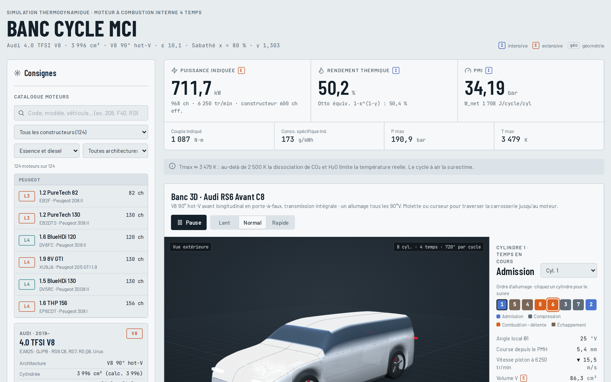
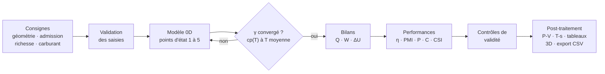
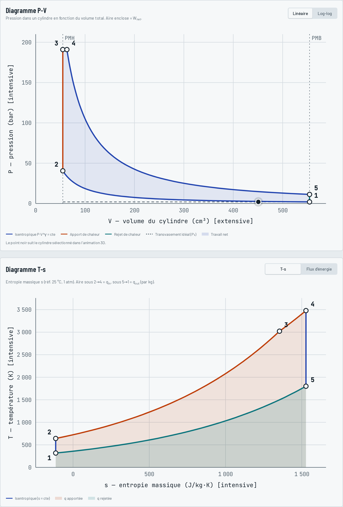
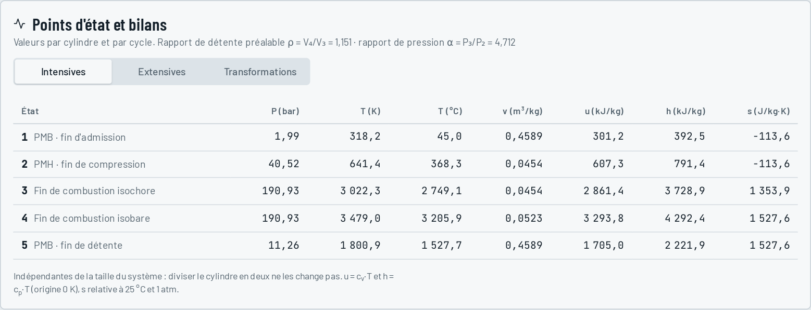

# Banc Cycle MCI

**Banc d'essai numérique pour moteurs à combustion interne 4 temps : modélisation thermodynamique 0D des cycles Otto, Diesel et mixte (Sabathé), du modèle physique au post-traitement.**

### ▶ [Ouvrir la démo en ligne](https://rauguiw.github.io/banc-cycle-mci/)

Aucune installation : l'outil s'ouvre directement dans le navigateur (ordinateur conseillé pour la vue 3D).

[](https://rauguiw.github.io/banc-cycle-mci/)


---

## En bref

Choisissez un moteur réel ou saisissez vos propres consignes (géométrie, admission, richesse, carburant, modèle de cycle). Le banc calcule alors en temps réel :

- les **5 points d'état** du cycle (P, T, V, u, h, s, en grandeurs intensives et extensives) ;
- le **bilan énergétique** de chaque transformation (Q, W, ΔU) ;
- les **performances indiquées** : travail par cycle, rendement thermique, PMI, puissance, couple, consommation spécifique, débits d'air et de carburant ;
- les **diagrammes P-V et T-s** et un synoptique des flux d'énergie ;
- une **animation 3D** du moteur (cinématique bielle-manivelle exacte, ordre d'allumage, distribution) implantée dans une silhouette de véhicule.

Le modèle s'auto-contrôle : des avertissements signalent quand une hypothèse sort de son domaine de validité (dissociation au-delà de 2 500 K, pression de pointe irréaliste, mélange riche, limite de fumée diesel, cliquetis…). Les résultats s'exportent en CSV.

## Démarche

Ce projet reprend la chaîne complète d'un outil de calcul de performances :



La même méthode (points d'état, bilans d'énergie, propriétés du gaz fonction de la température, résolution itérative, contrôles de cohérence, post-traitement) sert au calcul de cycle d'un turboréacteur. La section [Perspectives](#perspectives--du-moteur-à-pistons-au-turboréacteur) détaille cette transposition.

## Modèle physique

### Hypothèses

Cycle théorique à air en système fermé : gaz parfait ($R = 287{,}05$ J/kg·K), compression et détente isentropiques, combustion instantanée répartie entre une phase isochore et une phase isobare, pas de gaz résiduels ni de pertes aux parois. Les puissances calculées sont **indiquées**, c'est-à-dire avant frottements et pompage.

### Géométrie et masse enfermée

```math
V_d = \frac{\pi}{4}\,B^2 S \qquad V_c = \frac{V_d}{\varepsilon - 1} \qquad m = \frac{P_1 V_1}{R\,T_1}
```

### Apport de chaleur

```math
m_f = \frac{m}{\lambda \cdot AFR_{st}} \qquad Q_{in} = \min(1,\lambda)\, m_f \cdot PCI \cdot \eta_{comb}
```

En mélange riche, l'énergie libérée est plafonnée à λ = 1, faute d'oxygène pour brûler l'excédent de carburant.

### Transformations

Une fraction $x$ de $Q_{in}$ est apportée à volume constant, le reste à pression constante : $x = 1$ donne le cycle d'Otto, $x = 0$ le cycle Diesel et $0 < x < 1$ le cycle mixte de Sabathé.

| Transformation | Nature | Relations |
|---|---|---|
| 1 → 2 compression | isentropique | $T_2 = T_1\,\varepsilon^{\gamma-1}$, $P_2 = P_1\,\varepsilon^{\gamma}$ |
| 2 → 3 combustion | isochore | $T_3 = T_2 + \dfrac{x\,Q_{in}}{m\,c_v}$, $P_3 = P_2\,T_3/T_2$ |
| 3 → 4 combustion | isobare | $T_4 = T_3 + \dfrac{(1-x)\,Q_{in}}{m\,c_p}$, $V_4 = V_3\,T_4/T_3$ |
| 4 → 5 détente | isentropique | $T_5 = T_4\,(V_4/V_5)^{\gamma-1}$ |
| 5 → 1 échappement | isochore | $Q_{out} = m\,c_v\,(T_5 - T_1)$ |

Si la phase isobare atteint le point mort bas ($V_4 > V_1$), elle est tronquée et la chaleur restante n'est pas convertie ; le modèle le signale.

### γ variable : résolution itérative

En mode « γ estimé », $c_p$ de l'air suit le polynôme de Çengel (valide de 273 à 1 800 K) :

```math
\bar{c}_p(T) = 28{,}11 + 0{,}1967\cdot10^{-2}\,T + 0{,}4802\cdot10^{-5}\,T^2 - 1{,}966\cdot10^{-9}\,T^3 \quad \text{[kJ/kmol·K]}
```

On part de γ = 1,35, on résout le cycle, on évalue $\gamma(T_m)$ à la température moyenne des cinq états, puis on met à jour par relaxation jusqu'à $|\Delta\gamma| < 10^{-7}$ :

```math
\gamma_{k+1} = \tfrac{1}{2}\,\gamma_k + \tfrac{1}{2}\,\gamma\!\left(T_m(\gamma_k)\right)
```

### Performances

```math
W_{net} = \sum W_i \qquad \eta_{th} = \frac{W_{net}}{Q_{in}} \qquad PMI = \frac{W_{net}}{V_d}
```

```math
P_i = W_{net}\, n_{cyl}\, \frac{N}{120} \qquad C_i = \frac{P_i}{\omega} \qquad CSI = \frac{m_f}{W_{net}}
```

Le rendement obtenu est comparé à la référence d'Otto $1 - \varepsilon^{1-\gamma}$. L'entropie est calculée par $s = c_p \ln(T/T_{ref}) - R \ln(P/P_{ref})$, avec $T_{ref} = 298{,}15$ K et $P_{ref} = 101\,325$ Pa.

### Cinématique bielle-manivelle

Pour le diagramme P-V tracé à l'angle de vilebrequin et pour l'animation, avec $r = S/2$ et $L$ la longueur de bielle :

```math
x(\theta) = r\cos\theta + \sqrt{L^2 - r^2\sin^2\theta} \qquad V(\theta) = V_c + \frac{\pi B^2}{4}\left(L + r - x(\theta)\right)
```

## Catalogue de moteurs réels

**124 moteurs** de 28 constructeurs (104 essence, 20 diesel ; en ligne, en V, VR, W et boxer), du 3 cylindres 1.0 TSI au W16 Bugatti. Alésage, course, taux de compression, puissance et couple sont issus des fiches constructeur. Quand la longueur de bielle n'est pas publiée, elle est estimée à 1,62 × S.

Pour chaque moteur, la pression d'admission équivalente $P_1$ est **calée** pour retrouver la puissance annoncée, avec un rapport puissance effective / puissance indiquée théorique supposé de 0,62 (essence) ou 0,66 (diesel). $P_1$ représente donc une pression d'admission équivalente, pas la pression de suralimentation mesurée.

### Exemple : Audi 4.0 TFSI V8 (EA825), point de calage à 6 250 tr/min

| Point | P [bar] | T [K] | V [cm³] |
|---|---:|---:|---:|
| 1 · PMB, fin d'admission | 1,99 | 318 | 554,5 |
| 2 · PMH, fin de compression | 40,52 | 641 | 54,9 |
| 3 · fin de combustion isochore | 190,93 | 3 022 | 54,9 |
| 4 · fin de combustion isobare | 190,93 | 3 479 | 63,2 |
| 5 · PMB, fin de détente | 11,26 | 1 801 | 554,5 |

γ converge à 1,303 en 20 itérations. Rendement thermique 50,2 % (référence Otto : 50,4 %), PMI 34,2 bar, puissance indiquée 712 kW (968 ch) pour 600 ch effectifs annoncés. Le banc affiche ici un avertissement : $T_{max} \approx 3\,480$ K dépasse le seuil où la dissociation de CO₂ et H₂O limite la température réelle, que le cycle à air surestime.

<p align="center">
  
</p>



## Limites assumées

- Cycle à air : les propriétés des gaz brûlés et la dissociation ne sont pas modélisées.
- Combustion instantanée : pas de loi de dégagement de chaleur (type Wiebe), d'où une pression de pointe surestimée.
- Pas de gaz résiduels, de transferts aux parois, de pertes par frottement ni de travail de pompage.
- γ unique sur tout le cycle, évalué à la température moyenne.

Ces limites sont affichées dans l'outil et rappelées par les avertissements au moment du calcul.

## Organisation du code

L'application tient dans un seul fichier, [`index.html`](index.html), sans installation ni compilation : le code TypeScript/React est transpilé dans le navigateur par Babel au chargement.

| Bloc | Rôle | Lignes |
|---|---|---|
| Noyau thermodynamique | cp(T), résolution du cycle, itération sur γ, bilans, contrôles de validité | [`index.html#L197-L404`](index.html#L197-L404) |
| Cinématique | volume et vitesse du piston selon l'angle, levées de soupapes | [`index.html#L365-L403`](index.html#L365-L403) |
| Catalogue | 124 fiches moteur et calage de P₁ | [`index.html#L422-L851`](index.html#L422-L851) |
| Validation des saisies | plages admissibles, cohérence géométrique, ordre d'allumage | [`index.html#L914-L954`](index.html#L914-L954) |
| Post-traitement | diagrammes P-V et T-s, flux d'énergie, tableaux, export CSV | [`index.html#L1111-L1473`](index.html#L1111-L1473) |
| Rendu 3D | moteur et véhicule paramétriques (Three.js) | [`index.html#L1704-L2917`](index.html#L1704-L2917) |
| Interface | composition de l'application | [`index.html#L3019-L3259`](index.html#L3019-L3259) |

**Lancer en local :** télécharger `index.html` et l'ouvrir dans un navigateur (connexion Internet requise pour charger React, Three.js et Babel depuis leur CDN).

## Perspectives : du moteur à pistons au turboréacteur

La structure du noyau de calcul se transpose directement à un cycle de Brayton-Joule :

| Banc Cycle MCI | Cycle de turboréacteur |
|---|---|
| Points d'état 1 à 5 | Stations moteur (entrée d'air, compresseur, chambre, turbine, tuyère) |
| Compression isentropique 1 → 2 | Compresseur avec rendement isentropique ou polytropique |
| Apport de chaleur isobare 3 → 4 | Chambre de combustion (avec perte de charge) |
| Détente isentropique 4 → 5 | Turbine, puis détente dans la tuyère |
| cp(T) de l'air, γ itéré | Propriétés des gaz frais et des produits de combustion |
| PMI, puissance, CSI | Poussée spécifique, consommation spécifique (TSFC) |
| Calage sur données constructeur | Recalage du modèle sur essais |

Pistes d'évolution :

- ajouter un module de cycle de turbine à gaz simple flux puis double flux, avec rendements de composants ;
- porter le noyau de calcul en Python pour l'intégrer à des scripts de post-traitement et d'études paramétriques ;
- remplacer le cycle à air par des propriétés de gaz brûlés et une loi de combustion de Wiebe ;
- estimer les pertes mécaniques (corrélations de PMF) pour passer des grandeurs indiquées aux grandeurs effectives.

## Auteur

**Walid RAUGUI**, élève-ingénieur en Génie énergétique aux Arts et Métiers (ENSAM), en alternance. Projet personnel.

## Licence

Code distribué sous [licence MIT](LICENSE).
