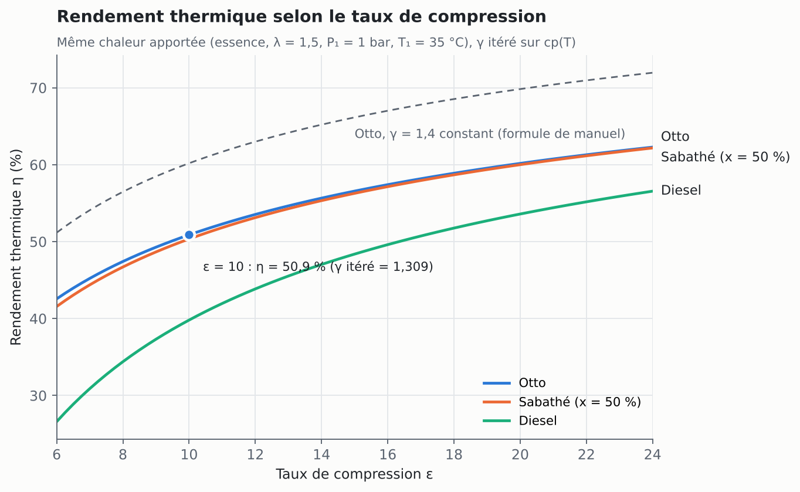
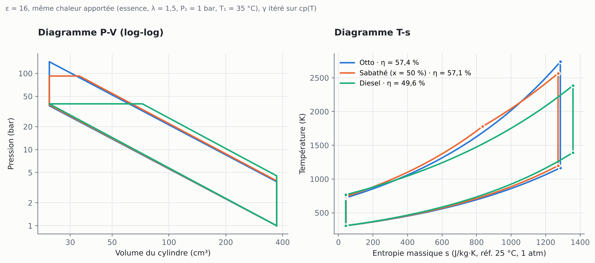
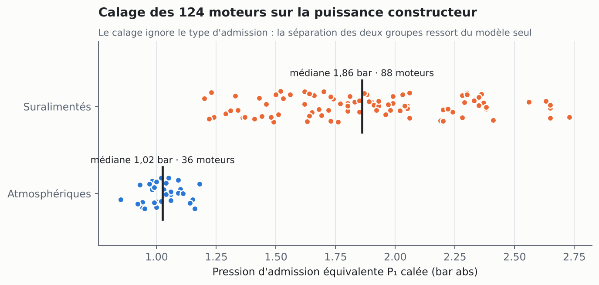

# cycle_mci : le noyau de calcul en Python

Portage Python du modèle thermodynamique 0D du [Banc Cycle MCI](https://rauguiw.github.io/banc-cycle-mci/), pour l'utiliser dans des scripts d'étude, de post-traitement ou d'automatisation.

- **Fidèle** : il reproduit le code JavaScript de l'application à la précision machine (écart relatif maximal 5 × 10⁻¹⁶ sur plus de 4 000 grandeurs comparées).
- **Sans dépendance** : la bibliothèque n'utilise que la bibliothèque standard ; NumPy et Matplotlib ne servent qu'aux exemples.
- **Testé** : 19 tests (concordance avec le JavaScript, solutions analytiques, premier principe, catalogue), exécutés à chaque modification par GitHub Actions sous Python 3.9, 3.12 et 3.13.

## Utilisation

```python
from cycle_mci import Consignes, calculer_cycle, calculer_moteur

# Configuration libre
res = calculer_cycle(Consignes(cycle="sabathe", epsilon=12, p1_bar=1.6, lambda_=1.0, part_isochore_pct=70))
print(f"η = {res.eta_th:.1%}, PMI = {res.pmi_bar:.1f} bar, γ = {res.gamma:.4f} en {res.iterations_gamma} itérations")
for e in res.etats:
    print(e.id, e.libelle, round(e.P / 1e5, 2), "bar", round(e.T), "K")

# Moteur du catalogue, au point de calage sur la puissance constructeur
audi = calculer_moteur("audi-40tfsi")
print(audi.puissance_kW, [a.texte for a in audi.avertissements])

# Étude paramétrique : les consignes sont immuables, .avec() crée une variante
base = Consignes(cycle="otto")
etude = {eps: calculer_cycle(base.avec(epsilon=eps)).eta_th for eps in range(8, 15)}
```

En ligne de commande, depuis ce dossier :

```text
$ python -m cycle_mci audi-40tfsi
Audi 4.0 TFSI V8 (EA825 · DJPB) — point de calage, constructeur 600 ch eff.
  Cycle sabathe, ε = 10.1, P1 = 1.99 bar, T1 = 45 °C, N = 6250 tr/min, λ = 1
  γ = 1.3032 (20 itérations), cv = 946.8, cp = 1233.8 J/kg·K

  État                              P [bar]     T [K]    V [cm³]   s [J/kg·K]
  1 PMB · fin d'admission               1.99     318.1      554.5       -113.6
  2 PMH · fin de compression           40.52     641.4       54.9       -113.6
  3 Fin de combustion isochore        190.93    3022.3       54.9       1353.9
  4 Fin de combustion isobare         190.93    3479.0       63.2       1527.6
  5 PMB · fin de détente               11.26    1800.9      554.5       1527.6
  …
  Rendement thermique        50.18 %   (Otto équivalent 50.40 %)
  PMI                        34.19 bar
  Puissance indiquée         711.7 kW  (968 ch)

$ python -m cycle_mci --liste                       # les 124 moteurs
$ python -m cycle_mci audi-40tfsi --cycle otto      # variante d'un moteur
$ python -m cycle_mci --cycle diesel --carburant diesel --epsilon 18 --lambda 1.5
```

## Organisation

| Fichier | Contenu |
|---|---|
| [`cycle_mci/thermo.py`](cycle_mci/thermo.py) | cp(T) de l'air, résolution des 5 états, itération sur γ, bilans, performances, avertissements de validité |
| [`cycle_mci/cinematique.py`](cycle_mci/cinematique.py) | bielle-manivelle : volume et vitesse du piston, levées de soupapes, état du gaz à l'angle θ |
| [`cycle_mci/catalogue.py`](cycle_mci/catalogue.py) | 124 moteurs réels, consignes pleine charge, calage de P₁ sur la puissance constructeur |
| [`cycle_mci/__main__.py`](cycle_mci/__main__.py) | interface en ligne de commande |
| [`tests/`](tests) | concordance avec le JavaScript et contrôles physiques |
| [`exemples/`](exemples) | études paramétriques et figures |
| [`outils/generer_reference.mjs`](outils/generer_reference.mjs) | exporte le catalogue et les valeurs de référence depuis `index.html` |

## Validation

**Concordance avec l'application.** [`outils/generer_reference.mjs`](outils/generer_reference.mjs) extrait le noyau de calcul et le catalogue directement de [`index.html`](../index.html) et les exécute avec Node. Les valeurs obtenues servent de référence aux tests :

- les 124 moteurs à leur point de calage ;
- 20 cas particuliers : Otto, Diesel et Sabathé, γ itéré ou imposé, mélanges riche et pauvre, phase isobare tronquée au PMB.

Les tests comparent les 5 états, les bilans, les performances, la cinématique et les avertissements. L'intégration continue régénère ces références à chaque modification et échoue si `index.html` et le portage Python divergent.

**Contrôles physiques**, indépendants du JavaScript :

- premier principe sur le cycle : ΣΔU = 0 et W_net = Q_in − Q_out ;
- rendements analytiques d'Otto, 1 − ε^(1−γ), et du Diesel, 1 − (ρ^γ − 1)/(γ ε^(γ−1) (ρ − 1)), à γ constant ;
- classement η_Otto > η_Sabathé > η_Diesel à chaleur apportée égale ;
- isentropiques à entropie constante ;
- plafonnement de l'énergie en mélange riche et troncature au PMB ;
- cp(T) à ±1,5 % des valeurs tabulées ;
- cylindrées recalculées à ±1 % des fiches constructeur.

```bash
python -m unittest discover -s tests -v
```

## Exemples

```bash
pip install numpy matplotlib
python exemples/etude_parametrique.py    # η en fonction de ε pour les trois cycles
python exemples/diagrammes_pv_ts.py      # P-V et T-s comparés
python exemples/catalogue_calage.py      # P₁ calée sur les 124 moteurs
```



Avec γ itéré sur cp(T), le rendement d'Otto à ε = 10 tombe à 50,9 %, contre 60,2 % pour la formule de manuel à γ = 1,4. L'échauffement du gaz fait baisser γ et, avec lui, le rendement.





Le calage de P₁ n'utilise que la puissance, la géométrie et le régime : il ignore le type d'admission. Il sépare pourtant nettement les 36 moteurs atmosphériques (P₁ de 0,85 à 1,18 bar, médiane 1,02) des 88 suralimentés (1,20 à 2,73 bar, médiane 1,86). C'est un contrôle de vraisemblance du modèle et des hypothèses de calage.
